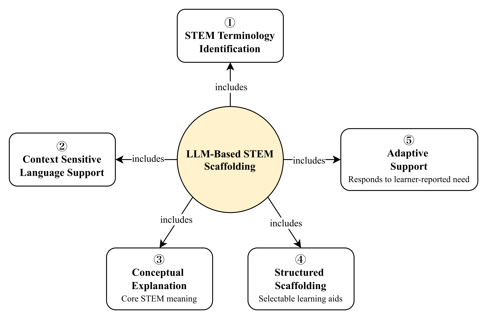
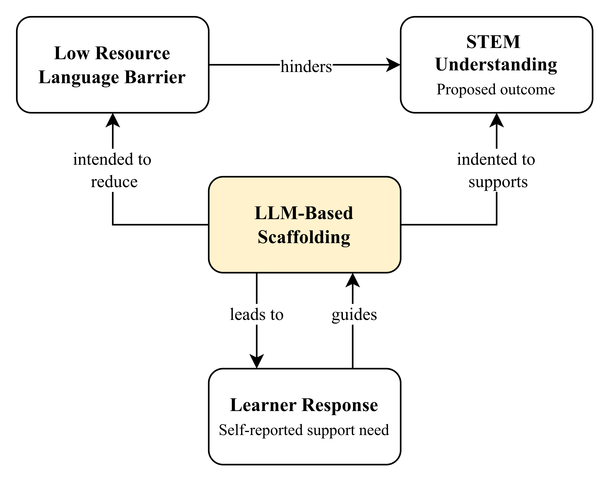
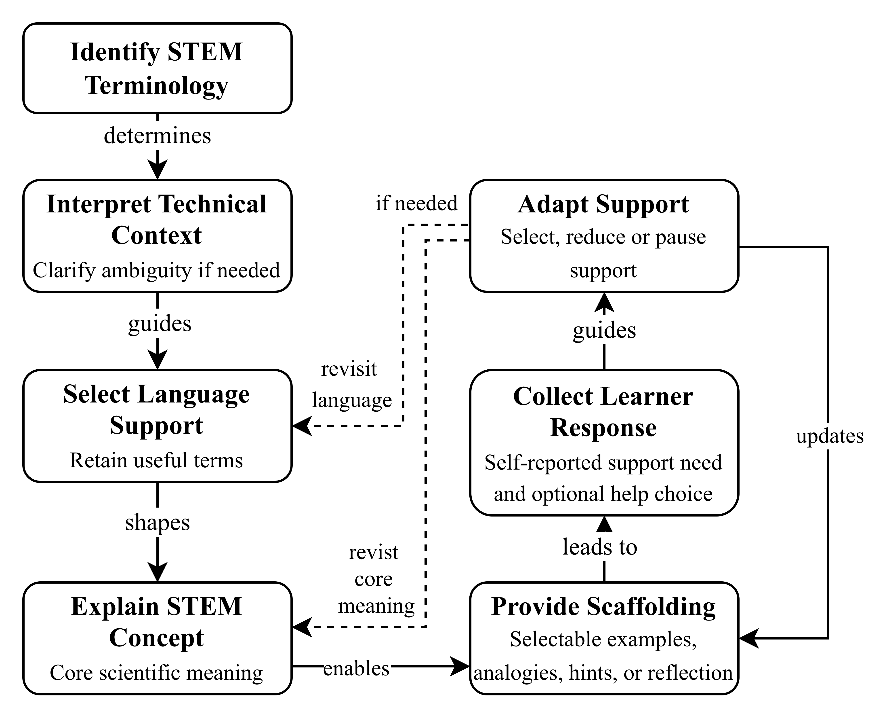

# Evaluated artefacts and visible changes

**Baseline:** CA-V2-20261023. The images below are frozen copies of the three supplied files. [Manifest](manifest.json) records their identities. Stage numbers below are reading aids; the framework image itself does not number its stages.

## CA1 — LLM-Based STEM Scaffolding Concepts

The central concept is **LLM-Based STEM Scaffolding**. Five outward arrows are labelled **includes**. They are membership relationships, not causal claims.

| Element | Exact visible wording, with line breaks normalised | Change from supplied v1 |
| --- | --- | --- |
| ① | STEM Terminology Identification | Retained |
| ② | Context Sensitive Language Support | Retained |
| ③ | Conceptual Explanation; Core STEM meaning | Clarifying subtitle added |
| ④ | Structured Scaffolding; Selectable learning aids | Clarifying subtitle added |
| ⑤ | Adaptive Support; Responds to learner-reported need | Clarifying subtitle added |

**Interpretation:** The five concepts describe types of support, not five consecutive stages. Context interpretation is a responsibility within the process, so its absence as a sixth concept is not automatically a missing capability.

**Remaining boundary:** “Selectable learning aids” does not specify which aid suits a particular need. The concept image also does not name Burmese/English or validate any generated explanation.

## CA2 — Task-Aligned LLM Scaffolding Model

| Construct | Exact visible wording |
| --- | --- |
| Barrier | Low Resource Language Barrier |
| Support | LLM-Based Scaffolding |
| Outcome | STEM Understanding; Proposed outcome |
| Feedback | Learner Response; Self-reported support need |

| ID | Visible directed relationship | Change from supplied v1 |
| --- | --- | --- |
| M1 | Low Resource Language Barrier → STEM Understanding: hinders | Retained |
| M2 | LLM-Based Scaffolding → Low Resource Language Barrier: intended to reduce | Intention qualifier added |
| M3 | LLM-Based Scaffolding → STEM Understanding: indented to supports | Apparent intended-effect wording, with spelling and grammar errors |
| M4 | LLM-Based Scaffolding → Learner Response: leads to | Retained |
| M5 | Learner Response → LLM-Based Scaffolding: guides | Retained |

**Exact-text correction:** The supplied image says **“indented to supports”**. Direct reinspection after the interview acknowledgement confirmed this. The earlier register and submitted context incorrectly transcribed it as “intended to supports”; that original prompt and all replies remain unchanged in the interview record. The suggested image correction is “intended to support”. See the [interview adjudication](../genai/interview_analysis.md#adjudication-and-implications).

**Interpretation:** “Intended to reduce” and “Proposed outcome” help qualify the intervention rationale. The right-hand arrow appears to intend similar qualification, but its misspelt wording needs correction. “Hinders” is a general problem assumption, not a newly measured causal effect. “Leads to” should describe an interaction opportunity rather than guarantee a learner response.

**Remaining boundary:** The model does not contain measures of task fit, learning, language-barrier reduction or self-report accuracy.

## CA3 — Context-Aware Adaptive STEM Scaffolding Framework

| Reading stage | Exact visible main label | Exact visible subtitle |
| --- | --- | --- |
| 1 | Identify STEM Terminology | None |
| 2 | Interpret Technical Context | Clarify ambiguity if needed |
| 3 | Select Language Support | Retain useful terms |
| 4 | Explain STEM Concept | Core scientific meaning |
| 5 | Provide Scaffolding | Selectable examples, analogies, hints or reflection |
| 6 | Collect Learner Response | Self-reported support need and optional help choice |
| 7 | Adapt Support | Select, reduce or pause support |

| ID | Visible directed relationship | Label and style |
| --- | --- | --- |
| P1 | 1 → 2 | determines; solid |
| P2 | 2 → 3 | guides; solid |
| P3 | 3 → 4 | shapes; solid |
| P4 | 4 → 5 | enables; solid |
| P5 | 5 → 6 | leads to; solid |
| P6 | 6 → 7 | guides; solid |
| P7 | 7 → 5 | updates; solid outer-right loop |
| P8 | 7 → 3 | revisit language; dashed, under “if needed” |
| P9 | 7 → 4 | revisit core meaning; dashed, under “if needed” |

The two dashed branches leave Stage 7 and point into Stages 3 and 4. There is no arrowhead pointing back into Stage 7 on those branches. Following either branch, the solid process can continue through explanation/scaffolding and response.

**Visible improvements:** Ambiguity clarification, term retention, core meaning, selectable support, self-report, optional help type, reduction/pause and additional feedback destinations are now stated.

**Remaining boundaries:** Stage 3 does not name Burmese/English or its selection factors. Stage 7 does not explicitly say “interpret reported need”. There is no late-correction arrow from Stage 7 to Stage 1/2, and no drawn exit/continuation condition for pause. The Stage 5 subtitle is close to the box edges and needs a layout check at final slide size.

## Comparison sources

The supplied [v1 concepts](../../../artefacts/conceptual/v1-concept-1.png), [v1 model](../../../artefacts/conceptual/v1-concept-2.png) and [v1 framework](../../../artefacts/conceptual/v1-concept-3.png) were inspected for the comparison. Their semantic structure matches the original Assignment 3 designs; they are not assumed to be byte-identical to embedded PDF images.

The [first evaluation](../../01_conceptual/conceptual_triangulation.md) is the source of earlier concerns and refinement decisions. The earlier presentation-generated images are not the evaluation target. In particular, fuller language and Stage 7 subtitles in those other images are not credited to these supplied v2 files.

